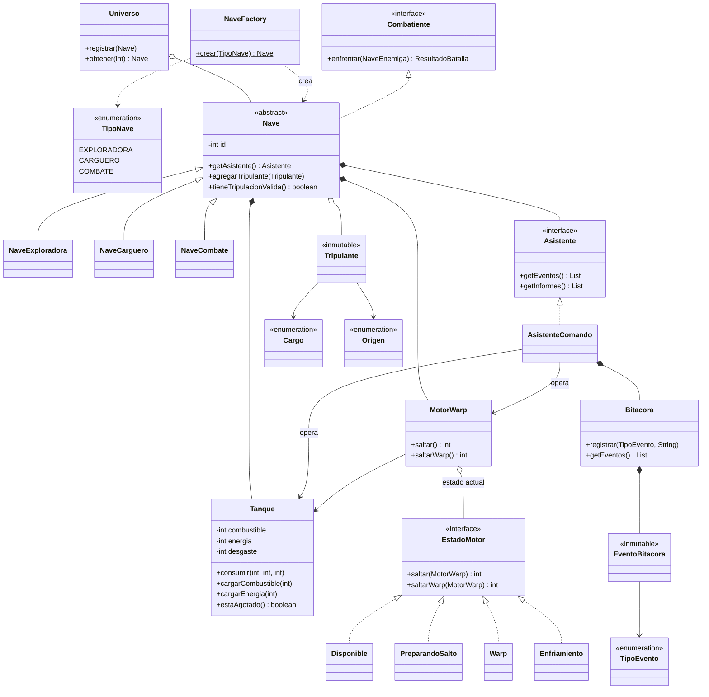
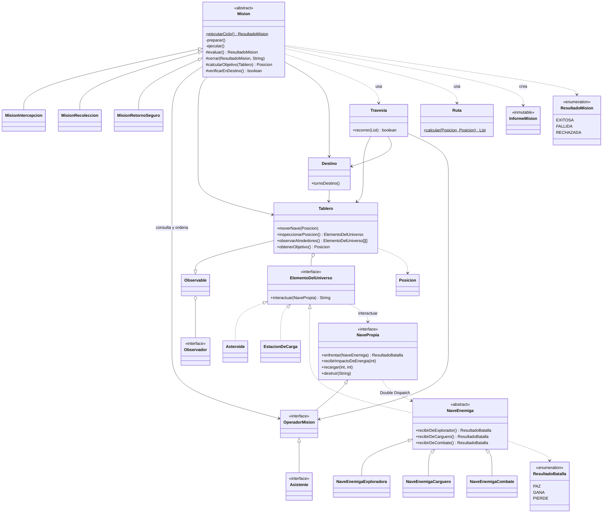
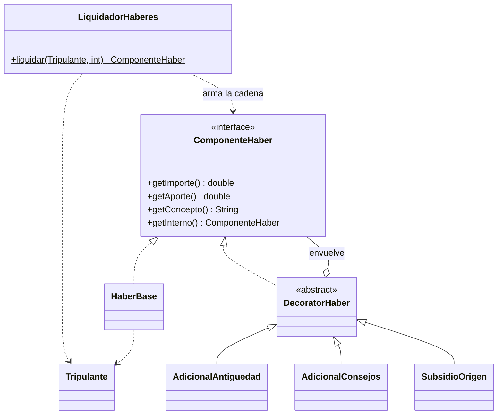
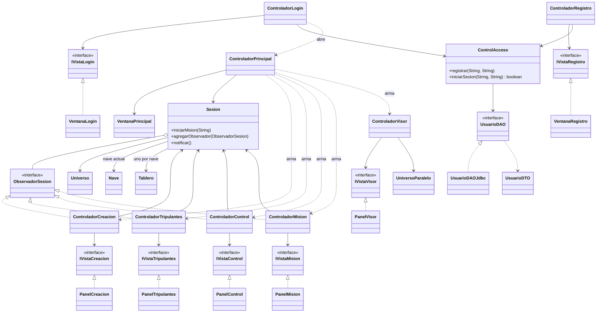
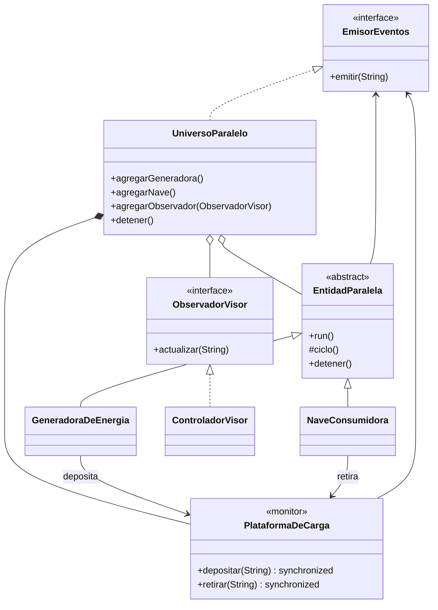

# Diagrama de clases — Entregas 1 y 2

Los diagramas están escritos en [Mermaid](https://mermaid.js.org/): GitHub los dibuja directamente al abrir este archivo. Para obtener una imagen, se pueden pegar en <https://mermaid.live> y exportar como PNG o SVG.

Se divide el sistema en cinco diagramas para que cada uno se pueda leer. Muestran las clases y relaciones principales, no todos los métodos. Las responsabilidades de cada clase están en [`../diseno.md`](../diseno.md).

Convenciones: `<|--` herencia, `<|..` implementa una interfaz, `*--` composición (el todo crea y es dueño de la parte), `o--` agregación, `-->` conoce o usa, `..>` depende o crea.

## 1. Núcleo: universo, naves, asistente y motor

## 2. Misiones, travesía y tablero

`Tablero`, `Destino`, `Observable`, `Observador` y `Posicion` son provistos por la cátedra.

## 3. Liquidación de haberes (Decorator)

## 4. Interfaz (MVC), sesión y persistencia

## 5. Universo paralelo (concurrencia)

